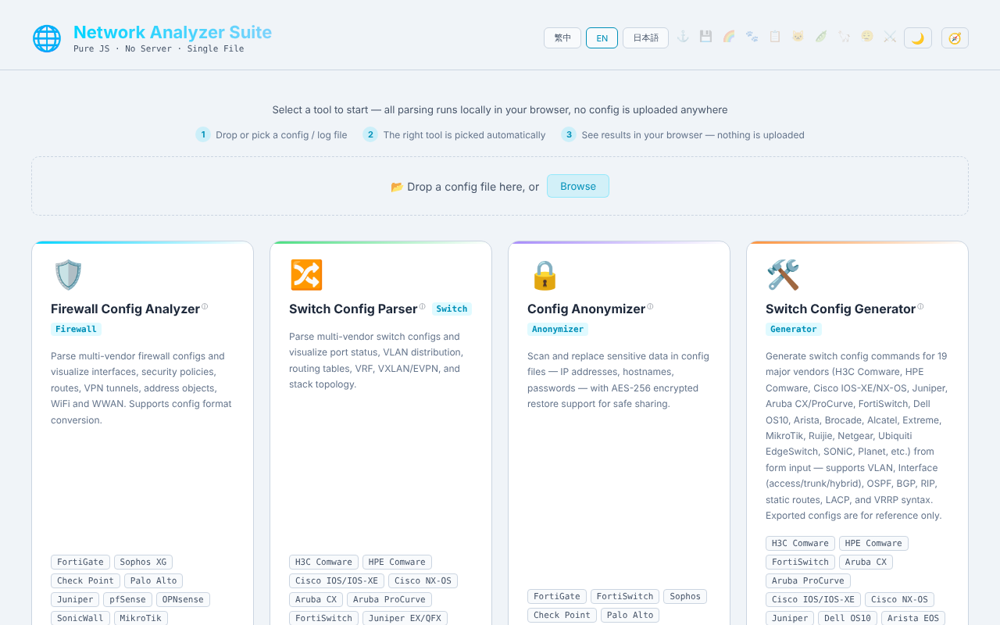
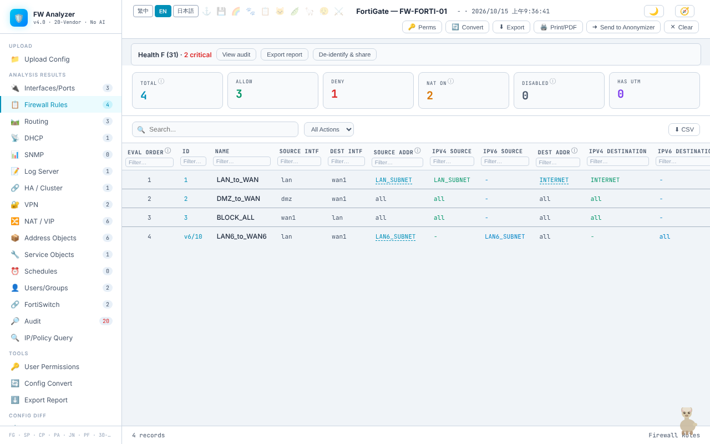
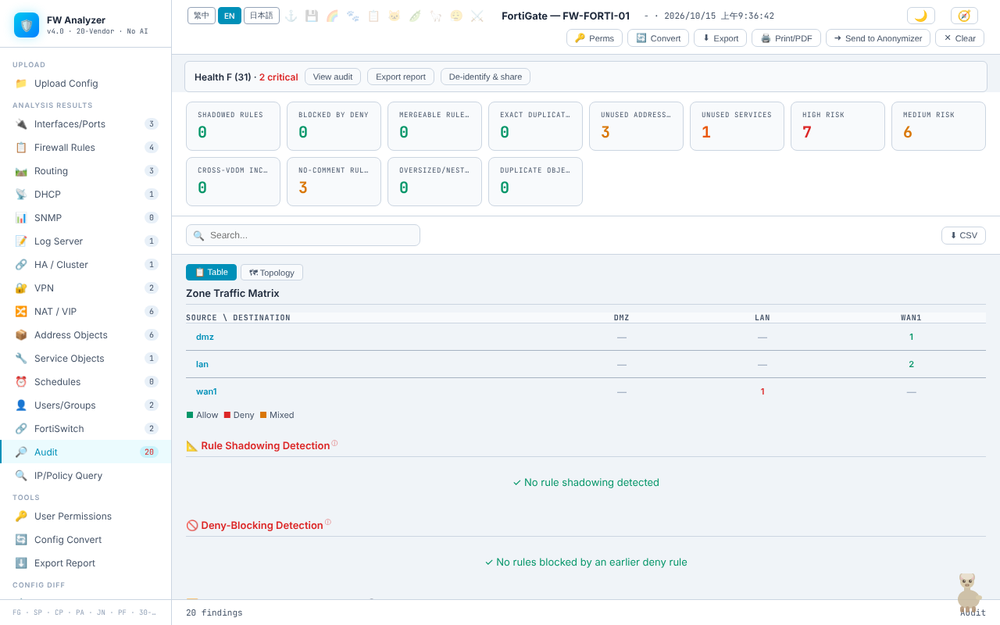
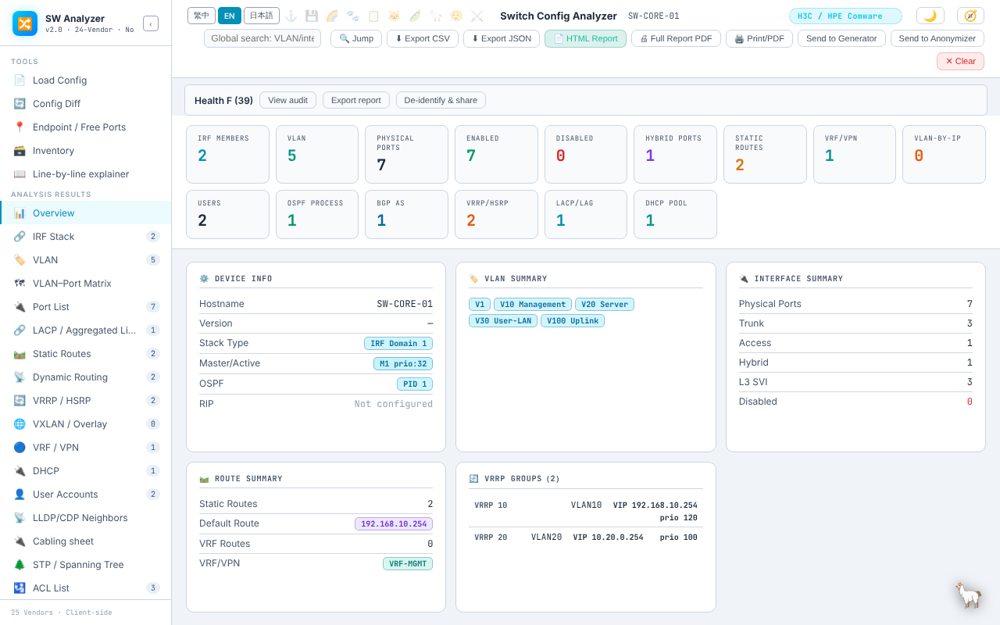
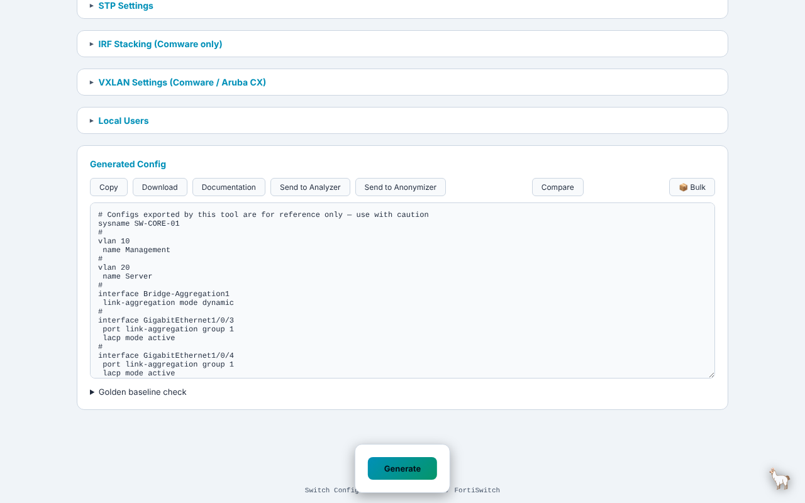
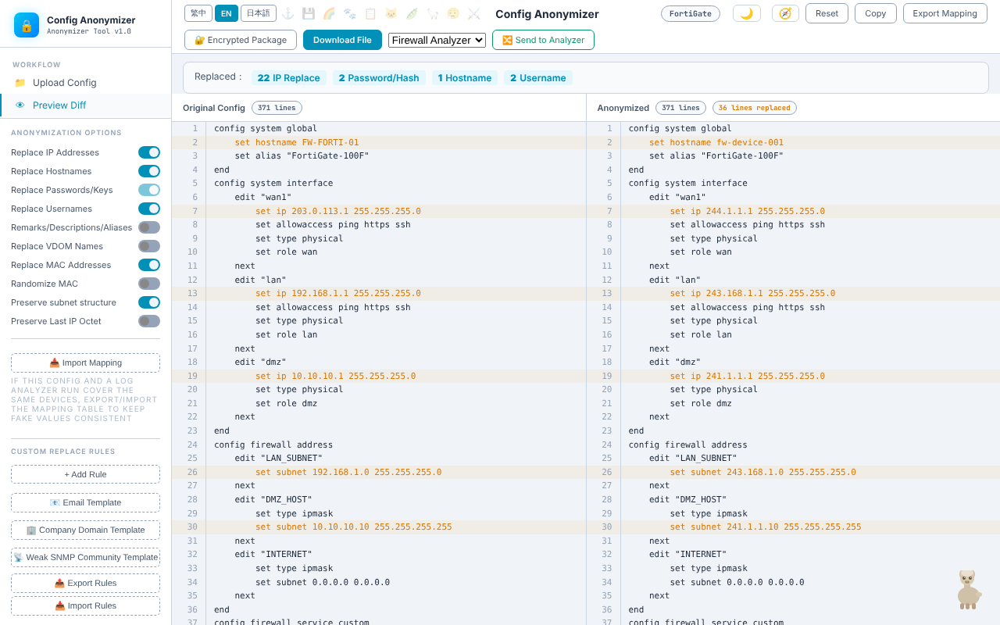
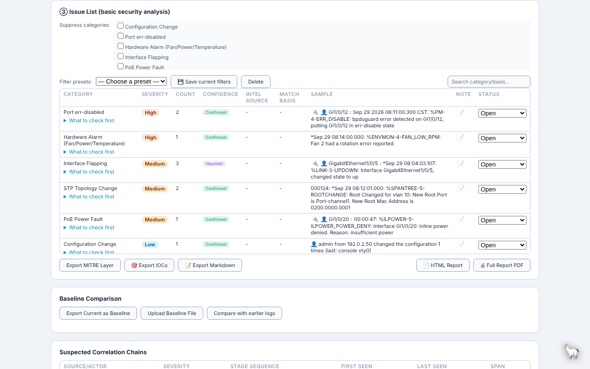

# 🦙 Alpaca Network Toolkit

[繁體中文](README.md) | **English**

Browser-based tools for parsing, anonymizing, comparing and generating multi-vendor firewall and switch configurations, plus a log analyzer. Plain front-end JavaScript that works offline after download.

> 🔒 **All parsing and processing happens locally in your browser. Configuration files and logs are never uploaded to any server.**

## Quick start

- **Use online (no download)**: https://s200070221.github.io/alpaca-network-toolkit/
- **Install as an app / use without network**: open the URL above once in Chrome or Edge and the whole toolkit is stored in the browser, so it keeps working offline (handy on isolated networks); the install icon in the address bar turns it into a standalone app. When online the latest version is always loaded.
- **Use offline**: download the whole repository, open `network-analyzer.html` in your browser and drop a config file or log onto it. The vendor is detected automatically and the matching tool opens.
- **Just try it**: every tool card on the entry page has a "Try sample" button that loads a sample and shows the results (or add `?demo=1` to a tool's URL). Each tool shows a three-step guide on first use, and the entry page has a searchable glossary of common terms.
- **Not sure how to get a config?** The switch tool's "How to get the config?" lists export commands for 20 vendors. If you paste into the wrong tool, the result bar offers to hand the content back to the entry page for detection.

## Tools at a glance

| Tool | What it does |
|---|---|
| 🌐 [Entry Page](#-entry-page) | Drop a file; the vendor is detected and the matching tool opens |
| 🛡️ [Firewall Config Analyzer](#️-firewall-config-analyzer) | Review rules, find which rule matches an IP/port, audit with a health score |
| 🔀 [Switch Config Parser](#-switch-config-parser) | Review ports, VLANs, routing and stack topology; security audit and cabling sheet |
| 🛠️ [Switch Config Generator](#️-switch-config-generator) | Generate switch configs from a form, or import an existing config to edit |
| 🔒 [Config Anonymizer](#-config-anonymizer) | Mask IPs, user names, passwords and other sensitive data before sharing a config |
| 📜 [Log Analyzer](#-log-analyzer-experimental) 🧪 | Sort logs by severity, flag likely problems, anonymize |

## 🌐 Entry Page

`network-analyzer.html`

- Drop config files or logs; the vendor is detected and the matching tool opens. Several files can be dropped at once, including .gz / .zip archives.
- "Anonymize & Analyze" masks sensitive data first, then sends the result to the analysis tool.
- Collects each tool's latest analysis results, shows how the score and issue count changed since the last run (with a small history sparkline), and can download a combined health report.
- Alpaca achievement badges unlock as you use the tools.
- Workspace export: save each tool's browser-stored settings to one file and restore them on another computer.

## 🛡️ Firewall Config Analyzer

`firewall-analyzer-fixed.html` + `firewall-analyzer-*.js`

**Supported sources (20)**
- FortiGate, Sophos XG, Check Point (Gaia clish or Management API JSON), Palo Alto (incl. Panorama), Juniper SRX, pfSense, OPNsense, SonicWall, MikroTik, Cisco ASA / FTD, Zyxel USG / ATP, WatchGuard Firebox, H3C SecPath
- EdgeRouter (EdgeOS), VyOS, OpenWrt (UCI), Netgate TNSR, Linux iptables / nftables
- Cloud: AWS security groups and network ACLs, Azure NSGs, Azure Firewall Policy, GCP VPC firewall rules and network firewall policies, Oracle Cloud security lists / NSGs, Kubernetes NetworkPolicy, Cisco Meraki MX (API response JSON)
- Wireless LAN controllers (WiFi analysis only): Cisco Catalyst 9800 / AireOS, Aruba controller / Instant, H3C WX

**Main features**
- Visualizes rules, routes, NAT, VPN and address objects
- IP/port lookup: which rule allows or blocks a given connection (destination NAT is applied when querying a public address); batch lookup checks many connections at once, also with destination NAT
- Rule change simulation: try disabling, deleting, changing the action of or moving rules, then compare lookup results and shadowed rules
- Tighten broad rules from real log traffic: when a log batch lookup hits a rule with any source, destination or service, the addresses and ports actually seen are listed, and a FortiGate command draft can be generated
- Shadowed-rule analysis, compliance audit (including IPv6 protection gaps) and health score
- Old-vs-new config comparison (including HA primary/secondary), conversion between config formats
- Rule hit-count import (FortiGate, Cisco ASA / FTD, Palo Alto, Juniper SRX) to find rules never hit or not hit for a long time
- Expired or soon-to-expire temporary rules, and duplicate objects (same value, different name)
- Annual rule review sheet: download it, fill in the review decision and import it back into the rule change simulation; for FortiGate, the matching delete and disable commands can be generated
- WiFi analysis: SSID encryption, PMF, hidden SSIDs, captive portal, client isolation and security grade (FortiGate, MikroTik, OpenWrt, pfSense and wireless LAN controllers)

## 🔀 Switch Config Parser

`switch-config-parser.html` + `switch-analyzer-*.js`

**Supported vendors (26)**
- H3C Comware, HPE Comware, Cisco IOS-XE, Cisco NX-OS, Cisco Business (CBS / SG), Aruba CX, Aruba ProCurve, Juniper EX / QFX, Arista EOS, Dell OS10
- FortiSwitch, Extreme ExtremeXOS, Extreme VOSS / Fabric Engine, Alcatel OmniSwitch, Ruckus-Brocade ICX, MikroTik RouterOS, Ruijie RGOS, Netgear M4300, Netgear Smart Managed Pro (GS7xx), Ubiquiti EdgeSwitch, Broadcom EFOS, Planet, Allied Telesis AlliedWare Plus, FS.com FSOS
- SONiC, NVIDIA Cumulus Linux (NVUE)

**Main features**
- Visualizes ports, VLANs, routing and stack topology
- Security audit with a health score (including baseline management checks: NTP, syslog, centralized authentication, login banner, plain HTTP, SSH v1, idle timeout), config comparison
- Cabling sheet and endpoint lookup (paste MAC / ARP tables to find which port a device is on)
- Export a port map CSV in the generator's format, edit it in the generator and regenerate the config
- Golden template: your own "must exist / must not exist" config rules, checked across several devices
- Multi-device VLAN matrix: VLANs × devices with declared names, SVIs and port counts, flagging VLANs declared on only one device, with mismatched names, or used but not declared

## 🛠️ Switch Config Generator

`switch-config-generator.html` + `switch-generator-*.js`

**Supported vendors (19)**
- H3C Comware, HPE Comware, Cisco IOS-XE, Cisco NX-OS, Aruba CX, ProCurve, Juniper, Arista, Dell OS10, FortiSwitch
- Brocade ICX, Alcatel, Extreme, MikroTik RouterOS, Ruijie, Netgear, EdgeSwitch, Planet, SONiC

**Main features**
- Generate configs from a form: VLANs, interfaces, IPv6, secondary IPs, OSPF / OSPFv3, BGP, VRRP, ACL, QoS, stacking and more
- CSV batch generation for many devices, template library
- Import an existing config into the form (or receive it directly from the Switch Config Parser)
- Port map CSV import and export: edit port descriptions and VLANs in a spreadsheet and apply them in one go
- Golden baseline check: after generating, check the output against the golden template rules shared with the Switch Config Parser; CSV batch generation checks every device too

## 🔒 Config Anonymizer

`config-anonymizer.html`

- Supports 43 firewall / switch / wireless controller / cloud config formats
- Consistently replaces IPs, hostnames, user names, passwords, keys, SNMP communities, MAC addresses and more; IPv4 and IPv6 supported
- Optional subnet preservation: addresses in the same subnet map to the same fake subnet, so lookups and routing results stay the same after anonymization
- Checks that the config structure is unchanged after anonymization
- The mapping table can be saved encrypted with AES-256 and restored later

## 📜 Log Analyzer (experimental)

`log-analyzer.html`

**Supported formats**
- CEF, LEEF, Syslog (RFC3164 / RFC5424, with fields extracted from JSON messages), JSON
- Firewalls: FortiGate key=value (including syslog forwarding), Cisco ASA / FTD, Palo Alto PAN-OS (including GlobalProtect / User-ID), Check Point Log Exporter, Cisco FTD Firepower events, Juniper SRX RT_FLOW and IDP / UTM, H3C SecPath session / filter logs, SonicWall, Sophos Firewall, MikroTik, EdgeRouter / VyOS and Linux iptables / nftables LOG, Windows Defender Firewall pfirewall.log, AWS Network Firewall, Azure Firewall
- Intrusion detection and endpoint protection: Suricata EVE JSON, Cisco Secure Endpoint (AMP) event JSON, Zeek (JSON / TSV), CrowdStrike Falcon streaming events, Microsoft Defender for Endpoint / 365 Defender
- DNS / DHCP: BIND, dnsmasq / Pi-hole, CoreDNS and Windows DNS debug logs with DNS anomaly detection (likely DGA, DNS tunneling, NXDOMAIN bursts); Windows DHCP, ISC dhcpd and dnsmasq lease logs (event addresses annotated with host names); Cisco Umbrella CSV
- Network devices and access control: Cisco IOS (including ACL logging), Comware device logs, Cisco ISE 802.1X / MAB authentication logs (repeated failures on a switch port link to the switch analyzer), Linux sshd / sudo (success after repeated failures), OpenVPN, strongSwan, FreeRADIUS (radius.log and radacct detail accounting files), OpenLDAP slapd / 389 Directory Server (bind failures, cleartext binds, bulk directory searches), HAProxy; VPN / RADIUS address assignments and DHCP leases map event addresses to accounts and hosts
- Servers and cloud: Windows events (XML, Winlogbeat / NXLog JSON, Event Viewer CSV, with logon failure reasons, password spraying, Remote Desktop, DCSync, high-risk AD changes, plus a host-to-host logon map and cross-domain logons across multiple hosts) and Sysmon, IIS / web, Squid access.log, AWS ELB and S3 access logs, AWS VPC / Azure NSG / GCP flow logs, Cloudflare Logpush (HTTP requests and firewall events)
- Cloud identity and audit: Microsoft Entra ID sign-ins, Okta, Microsoft 365 audit, Google Workspace logins, Duo authentication logs, AWS CloudTrail, Azure Activity Log, GCP Cloud Audit Logs, Kubernetes audit logs

**Main features**
- Sorts by severity and flags likely problems: frequency anomalies, scans, authentication failures, Kerberoasting, lateral movement, interface problems, MAC flapping, multi-stage attack chains and more, tagged with MITRE ATT&CK IDs
- Local threat-intel, file-hash and ASN list matching (no network access; imports OTX, URLhaus, MISP, ThreatQ, STIX 2 and MalwareBazaar exports directly)
- Import Sigma rules (.yml; common detection syntax and modifiers are supported, and unsupported rules are listed with the reason)
- Upload .gz / .zip archives directly; each file inside an archive is treated as a separate source
- Privileged activity outside working hours (custom working hours, time zone and holidays); after loading a previous-period log, flags accounts active at hours they never used before or signing in from sources not seen before
- Actor view: events, 24-hour activity, top peers and address ownership for one account or address
- Previous-period comparison: new, resolved and ongoing issues with count changes
- Anonymization of sensitive fields, CSV and report export
- Send an event to the Firewall Analyzer to find the matching rule; send an interface problem to the Switch Config Parser to view that port

Two optional helpers prepare intel lists; the Log Analyzer itself stays offline:
- `threat-intel-builder.html` (Threat-Intel List Builder): tick public intel sources to fetch in the browser, add your own sources, or drop in files you downloaded; it builds IP/CIDR (including IPv6), domain, file hash and ASN lists that you can send straight to the Log Analyzer or download for import. Only sites that allow cross-origin reads can be fetched directly; download the others manually.
- `fetch_threat_intel.ps1`: a PowerShell script suited to scheduled IP list updates on Windows.

## User guides

Detailed guides are in `docs/` (.docx, currently in Traditional Chinese only):

- [Firewall Config Analyzer](docs/firewall-analyzer-guide.docx)
- [Switch Config Parser](docs/switch-config-parser-guide.docx)
- [Switch Config Generator](docs/switch-config-generator-guide.docx)
- [Config Anonymizer](docs/config-anonymizer-guide.docx)
- [Log Analyzer](docs/log-analyzer-guide.docx)
- [Entry Page](docs/network-analyzer-guide.docx)
- [Tool integration guide](docs/tool-integration-guide.docx): how the tools hand data to each other (for example, sending a log event to the Firewall Analyzer to find the matching rule) and what to prepare for each

## Download notes

- Some tools consist of an `.html` file plus several `.js` files. **Keep the `.js` files in the same folder as the `.html` file** when downloading or sharing; a single `.html` file on its own will not work, so downloading the whole repository is recommended.
- For a true single-file version (for example, to send as one attachment), run `build-standalone.ps1`; merged files are written to `dist/`.
- The UI is available in Traditional Chinese, English and Japanese (plus several hidden easter-egg languages).

## License and usage restrictions

This repository does **not** grant any open-source license. Content is provided for viewing and personal evaluation only. Copying, modification, redistribution and commercial use are **not permitted** without explicit permission from the author.

## Disclaimer

All configuration text exported or generated by these tools is for reference only. Review and verify it carefully before applying it to any device; you use it at your own risk.
